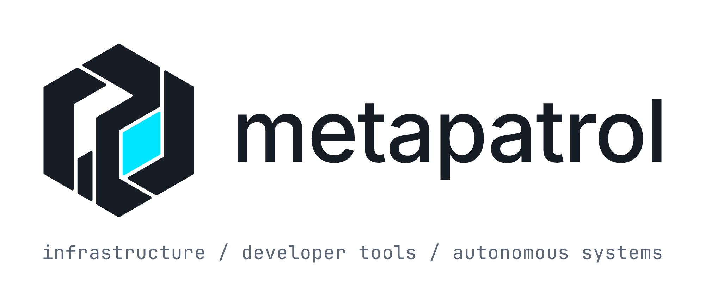

  <picture>
    <source media="(prefers-color-scheme: dark)" srcset="assets/metapatrol-lockup-descriptor-dark.png">
    
  </picture>

  <strong>Small, composable infrastructure and developer tools.</strong>

---

## Projects

| | |
|---|---|
| [mcp-gateway](https://github.com/metapatrol/mcp-gateway) | One governed MCP endpoint in front of every MCP backend in a Kubernetes cluster: one token, per-caller tool grants, every call authorised. |
| [forgejo-github-bridge](https://github.com/metapatrol/forgejo-github-bridge) | Develop in a private Forgejo, take contributions on GitHub: issues, pull requests and conversations cross between the two. |
| [brand](https://github.com/metapatrol/brand) | The metapatrol identity as code: one look for every project, from a version bump. |

## Contributing

Each project is developed in a private Forgejo and mirrored here. Issues and
pull requests on GitHub are welcome: forgejo-github-bridge carries them to the
maintainers and brings their replies back. Every repository's `CONTRIBUTING.md`
says how, and security problems go to private vulnerability reporting, not to
a public issue.
